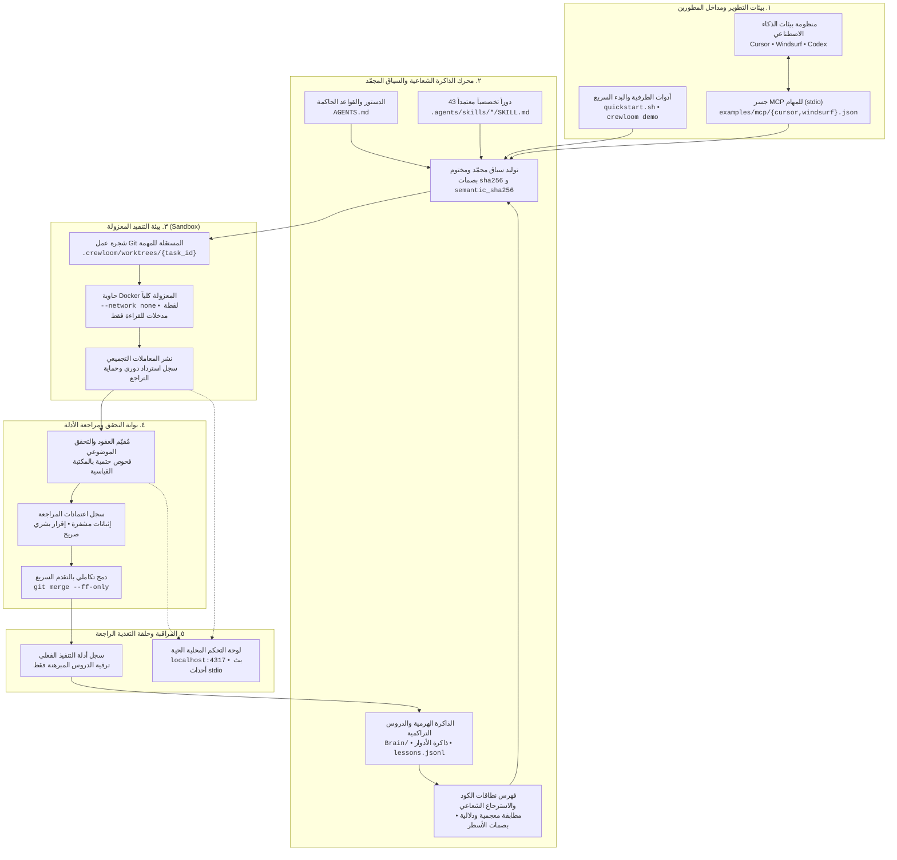

# Crewloom

<p align="center"></p>

<p align="center">
<a href="https://github.com/elbayoumi/crewloom/actions/workflows/ci.yml"></a>
<a href="https://github.com/elbayoumi/crewloom/releases/latest"></a>
<a href="LICENSE"></a>

<a href="https://modelcontextprotocol.io"></a>
<a href="https://github.com/elbayoumi/crewloom/stargazers"></a>
</p>

<p align="center"><a href="README.md">English</a> · <a href="documentation/SKILLS.md">43 دوراً</a> · <a href="documentation/TOOLS.md">دليل الأدوات</a> · <a href="examples/README.md">أمثلة التشغيل</a> · <a href="dashboard/README.md">لوحة التحكم الحية</a> · <a href="CONTRIBUTING.md">المساهمة</a></p>

أدوات وإجراءات لتنظيم شغل وكلاء الذكاء الاصطناعي داخل الريبو: تختار الدور، توفر بيانات المشروع، تحفظ الذاكرة، وتفحص المخرجات.

- **43 دليل دور بالإنجليزية** و**153 مراجع تفصيلية** تتضمن إجراءات المصدر بالعربية.
- **19 أداة Python** للفحوص والسياق وقياس الموارد والتوقيت والإنفاق.
- خمس ملفات ذاكرة لكل دور، وفحوص قبل الـcommit وفي GitHub Actions.

## البدء السريع والعرض التفاعلي في 20 ثانية

شغّل سكريبت التهيئة الفوري أو جرّب العرض التفاعلي الموجّه:

```bash
# تهيئة سريعة وفحص للمتطلبات بنقرة واحدة
./quickstart.sh

# عرض تفاعلي خلال 20 ثانية (اختيار الدور، استشارة الذاكرة، والتحقق من عزل الحاوية)
python3 scripts/crewloom.py demo --fast
```

سكريبت [البدء السريع](quickstart.sh) يتحقق من متطلبات النظام، ويهيئ البيئة، ويتيح التحقق الفوري دون الحاجة إلى مفاتيح API خارجية.

## معمارية النظام وتدفق العمل

يوضح المخطط أدناه دورة حياة المهمة عبر بيئات التطوير، ومحرك الذاكرة الشعاعية، وحاوية التنفيذ المعزولة، وبوابات مراجعة الأدلة:



## مقارنة أطر عمل الوكلاء

| البُعد / الخاصية | Crewloom | CrewAI | AutoGen (AG2) | LangGraph |
| :--- | :--- | :--- | :--- | :--- |
| **المعمارية الأساسية** | **أدوات داخل المستودع مباشرة**؛ مكتبة بايثون القياسية (Python 3.9+)؛ تزوّد بيئات العمل الحالية بـ 43 دوراً تخصصياً. | إطار عمل تطبيقي مستقل؛ حزم ثقيلة (Pydantic, LiteLLM)؛ محاكاة أدوار فرق العمل. | بيئة محادثات متعددة الوكلاء؛ حلقات تبادل رسائل؛ استخراج الشيفرة وتشغيلها. | مكتبة آلات حالة رسومية؛ ارتباط وثيق بمنظومة LangChain. |
| **تدرج الذاكرة والاسترجاع** | **ذاكرة هرمية ذات 3 طبقات** (`Brain/`، ذاكرة الأدوار، سياق المشروع المجمّد)؛ بصمات `sha256` للأسطر؛ دروس مُرقّاة بالأدلة فقط. | قاعدة متجهات (ChromaDB) وSQLite؛ بحث أجزاء نصية دون التحقق من بصمات أسطر الكود. | سجل رسائل المحادثة النصي؛ ملحقات RAG خارجية اختيارية؛ غياب هيكل الذاكرة المدمج. | نقاط تفتيش للحالة (Checkpointers)؛ تفويض استرجاع المتجهات لمكتبات خارجية. |
| **عزل التنفيذ والأمان** | **عزل كامل داخل Docker (`--network none`)**؛ لقطات مدخلات للقراءة فقط؛ نشر معاملات دوري مع سجل تراجع واسترداد. | تنفيذ مباشر على نظام التشغيل المضيف؛ عزل Docker اختياري دون حظر صارم للشبكة أو سجل ملفات. | منفّذ Docker اختياري مع اتصال شبكي نشط افتراضياً؛ غياب سجل استرداد المعاملات. | غياب بيئة العزل المدمجة؛ تنفيذ مباشر على المضيف أو تفويض لمزودي بيئات خارجية. |
| **هندسة التنسيق والتحكم** | **مسارات عمل حتمية (DAG)**؛ أشجار عمل Git متزامنة؛ دمج تكاملي بمراجعة موثقة وتقدم سريع (`--ff-only`). | تدفق تسلسلي أو هرمي؛ عرضة لحلقات المحادثة غير المنتهية وتكرار التوجيهات وهدر التوكنز. | محادثات جماعية حرة (GroupChat)؛ حساسية لانقطاع شروط التوقف واستمرار الحوار. | رسوم بيانية موجهة ذات حالات؛ دعم الحلقات المنضبطة والمقاطعة البشرية؛ كود ربط مكثف. |
| **تجربة التطوير المحلي** | **انعدام الاحتكاك**: سكريبت `quickstart.sh` فوري، وعرض تفاعلي في 20 ثانية (`crewloom demo`) دون مفاتيح API. | احتكاك تثبيت عالٍ؛ حزم ضخمة؛ اشتراط مفاتيح API مدفوعة لتشغيل أول مثال تجريبي. | يتطلب إعداد بيئة افتراضية وضبط `OAI_CONFIG_LIST` ومفاتيح مزودي الخدمة. | يتطلب تثبيت حزم متعددة ومفاتيح نماذج وربط العقد البرمجية يدوياً. |
| **التكامل مع بيئات IDE وMCP** | **خادم MCP مدمج عبر `stdio`** مع صلاحيات أمان دقيقة مخصصة لـ Cursor وWindsurf وCodex. | يفتقر لخادم MCP مدمج؛ يعتمد على تشغيل سكربتات خارجية. | يعمل كعميل لأدوات MCP فقط؛ لا يقدّم سياق المستودع أو حزم المهام للـ IDEs. | يعمل كعميل استدعاء أدوات فقط؛ يفتقر إلى جسر مهام مستودع موجه للبيئات البرمجية. |
| **الاعتمادية السحابية** | **100% محلي وبلا اتصال**؛ دون تتبع سحابي؛ لوحة تحكم محلية فورية على `localhost:4317`. | توجيه متكرر نحو منصة CrewAI Enterprise السحابية. | مكتبة مستقلة مع ملحقات اختيارية. | ارتباط تجاري قوي بمنصة LangSmith السحابية للمراقبة والتقييم. |

## ابدأ عمليًا

تحتاج Git وPython 3.9 أو أحدث.

```bash
git clone https://github.com/elbayoumi/crewloom.git
cd crewloom
python3 scripts/crewloom.py tools
python3 scripts/crewloom.py run workflow-contract -- examples/workflows/valid.json
python3 scripts/crewloom.py run seo-packet -- --packet examples/seo/article-packet.json
```

المثالان يطبعان `PASS`. باقي الأمثلة وأوامرها في [دليل الأمثلة](examples/README.md).

افتح المشروع في أداة الوكيل واطلب منه:

> اقرأ AGENTS.md ومهارة frontend-ux-auditor ومراجعها والبرين. استخدم العربية. راجع واجهة مشروعي، وشغّل الفحوص المناسبة، واعرض المشاكل بمواقع الملفات وأدلة التحقق. حدّث الذاكرة بعد الانتهاء.

```bash
python3 scripts/crewloom.py context frontend-ux-auditor --language ar --out /tmp/crewloom-ar.md
```

[مسارات العمل](documentation/WORKFLOWS.md) توضح ترتيب الأدوار والمدخلات والمخرجات. الوكيل والنموذج وأدوات الفيديو والمنصات الخارجية توفرها بيئة مشروعك. فحوص الكود الثابتة لا تثبت جودة العرض الفعلي، وفحص ملفات الأدلة لا يثبت صحة محتواها.

الأساس والتوثيق الرئيسي بالإنجليزية. لا توجد حزمة منشورة على npm أو PyPI أو خدمة استضافة للوكلاء. الترخيص [Apache-2.0](LICENSE)، مع حفظ [نسبة المصدر](NOTICE) لوكالة رموز.

## استخدمه داخل مشروعك

```bash
python3 -m venv .venv
source .venv/bin/activate
python -m pip install -e .
crewloom install --host claude --target /path/to/project --skill frontend-ux-auditor
crewloom dashboard
```

أوامر تفعيل البيئة أعلاه لـmacOS وLinux. `--host claude` ينسخ الأدوار إلى `.claude/skills`، و`--host agents` إلى `.agents/skills`. لا يكتب فوق دور موجود بدون `--force`. الداشبورد يحتاج Node 24+؛ يفتح `crewloom dashboard` محليًا على `127.0.0.1` دون كلمة مرور أو توليد رمز. تظل فحوص العنوان المحلي ومصدر الطلب مفعّلة. الاستضافة على واجهة غير محلية تتطلب ضبط `CREWLOOM_DASHBOARD_TOKEN` صراحةً. انظر [الداشبورد](dashboard/README.md).

الجسر الاختياري [Project Task MCP](documentation/MCP_BRIDGE.md) يربط الأدوات بمشروع ومهمة محددين؛ يحتاج Python 3.11+ وتثبيت `python -m pip install '.[mcp]'`. قوالب التهيئة المختبرة متوفرة لـ [Cursor](examples/mcp/cursor.json) و [Windsurf](examples/mcp/windsurf.json) (انظر [دليل إعداد MCP](examples/mcp/README.md)). القراءة هي الوضع الافتراضي، واستيراد الملفات والتحقق يحتاجان تفعيلًا صريحًا. [إضافة المتصفح](documentation/CHROME_EXTENSION_SIDE_PANEL.md) أدوات يدوية، و[قبول سطح المكتب](documentation/NATIVE_DESKTOP.md) محدود بتطبيق الاختبار المصرّح به.

إصدار المصدر الحالي `0.6.1`؛ راجع وسوم الإصدارات في المستودع لمعرفة ما نُشر فعلاً. [قائمة التحقق للإصدار](documentation/RELEASE.md) تفصل اختبارات الكود عن أدلة جودة الأدوار وعن النشر الفعلي.

## مسار برمجي قابل للتشغيل

أضفنا تنفيذًا معزولًا عبر Docker، وحالة استئناف، وحزمة تسليم بين الأدوار، وفحص جاهزية البيئة. المثال البرمجي ينفذ ست مراحل ويفحص التعامل مع العربية والإنجليزية. راجع [دليل التنفيذ](documentation/EXECUTION.md) و[إعداد المضيف](documentation/HOSTS.md). مثال التنفيذ يستخدم كودًا مرجعيًا جاهزًا؛ لا يثبت جودة توليد الوكيل.

## توليد ملفات عبر نموذج فعلي

[مثال التشغيل الآلي](examples/model-workflow/README.md) يولّد كودًا عبر Codex أو Claude، ثم يشغّل اختبارات داخل Docker. الأدوات تحتاج تسجيل الدخول المحلي للمضيف. [التقييم المتكرر](examples/evaluation/unicode-slug/HOST_TRIALS.md) يفصل توليد الملفات عن تصحيحها، ويسجّل المحاولات الفاشلة بوضوح. نجاح التوليد وحده ليس قبولًا لجودة الكود.

## التعديل الذاتي

[وضع التعديل الذاتي](documentation/SELF_EDITING.md) هو مسار تحسين الأدوار والأدوات والتوثيق الموجودة: تشخيص المشكلة، تعديل التنفيذ، التحقق، ثم تسجيل النتيجة. الاسم الإنجليزي: **Self-Editing Mode**. شغّله بطلب واضح لوكيلك مع تحديد المشروع والمشكلة؛ لا يضيف صلاحيات إلى المضيف.

## سياق المشروع

[سياق المشروع](documentation/PROJECT_CONTEXT.md) اختياري لكل مشروع، ويضيف هوية مشروع صالحة، وربطًا محليًا لنسخة العمل، وسياقًا مجمدًا لكل مهمة مع مراجع أسطر مُتحقَّق من بصمتها، ودروسًا لا ترفعها إلا أدلة تنفيذ مسجّلة.

```bash
crewloom project enter  --project /path/to/project --project-id sample-project --task-id login-fix --role context-guardian --seed src/auth.py
crewloom project status --project /path/to/project --project-id sample-project
crewloom project finish --project /path/to/project --project-id sample-project --task-id login-fix --evidence '[{"workflow": "login-flow", "step": "acceptance", "scope": "unit tests"}]'
```

الدخول ينشئ الناقص ويحدّث الموجود دون إعادة كتابة دستور مشروعك أو ذاكرة أدوارك. `status` يوضّح هل دورة الحياة يديرها مشغّل Crewloom أم أنها مُساعَدة بتعليمات أم يدوية؛ فتح المجلد لا يستدعي شيئًا وحده. `finish` لا يعلن الاكتمال إلا من أدلة تنفيذ مسجّلة، أما `--verification` فيسجّل إقرارًا يدويًا ويُبقي المهمة بانتظار التحقق. راجع [القياس التجريبي](documentation/PROJECT_CONTEXT.md#measurements) للسلوك المقيس فعليًا.

## تنفيذ المهام المستقلة على نحو متزامن

المهام المستقلة في مشروع واحد تُنفَّذ كدفعة واحدة: لكل مهمة شجرة عمل Git خاصة داخل `.crewloom`، وتعمل داخلها نفس منفّذ Docker المعزول، وتقرأ المهمة التابعة مخرجات أسلافها الملتزَمة فعلًا.

```bash
crewloom coordinator validate --project /path/to/project --project-id sample-project --manifest coordinator.json
crewloom coordinator run      --project /path/to/project --project-id sample-project --manifest coordinator.json
crewloom coordinator prepare  --project /path/to/project --project-id sample-project --manifest coordinator.json
```

لا تتغيّر الشجرة المفحوصة إلا بعد قرار مراجعة صريح ينقلها بخطوة «تقدّم سريع» واحدة مسجّلة. راجع [دليل المنسّق](documentation/COORDINATOR.ar.md) و[مرجعه الإنجليزي](documentation/COORDINATOR.md).

إعداد دورة التشغيل في الأدوات المدعومة: [دليل التشغيل التلقائي](documentation/HOST_LIFECYCLE.md). فحص ملفات تجهيز العملاء دون تعديلها: [دليل الجاهزية](documentation/READINESS.md).

[مثال تطوير تطبيق كامل](documentation/DEVELOPMENT_EXAMPLE.md): مهام فواتير وتخطيط متوازية، تقرير عربي أو إنجليزي، دمج واختبارات Docker، ثم نشر بمراجعة موثقة. اختبارات المكتبة تستبدل توليد المزوّد فقط بكود مرجعي؛ لا تمثل قياسًا لجودة النموذج. [دراسة السياق](documentation/CONTEXT_STUDY.md) تقيس التوكنز والكاش والوقت والصحة بصورة منفصلة، وتترك القياسات غير المتاحة مجهولة.

راجع [دعم العربي والإنجليزي ومعايير قبولهما](documentation/LANGUAGES.md) لمعرفة سلوك الواجهة وحدود ترجمة المخرجات والأدوات.
